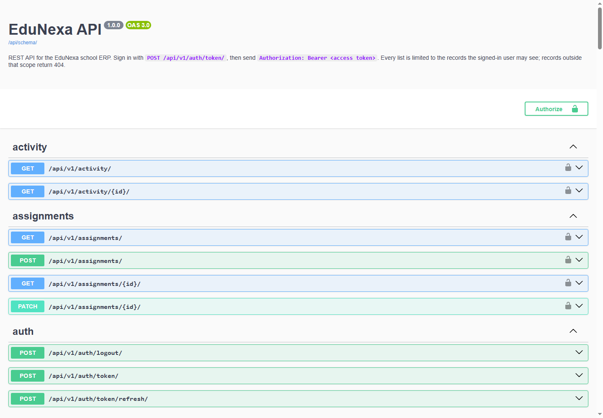

# REST API

EduNexa has a JSON API at `/api/v1/` with the same features, permissions and business rules as the web app. Interactive documentation, generated from the code:

| Page | URL |
|---|---|
| Swagger UI (try requests in the browser) | `/api/docs/` |
| ReDoc (reference) | `/api/redoc/` |
| OpenAPI 3 schema | `/api/schema/` (also a CI artifact on every build) |



## Quick start

```powershell
# 1. Sign in: an access token (15 minutes) and a refresh token (1 day)
$tokens = Invoke-RestMethod -Method Post http://127.0.0.1:8000/api/v1/auth/token/ `
  -ContentType "application/json" -Body '{"username": "teacher.madhapur", "password": "<demo password>"}'

# 2. Call the API with the access token
$auth = @{ Authorization = "Bearer $($tokens.access)" }
Invoke-RestMethod http://127.0.0.1:8000/api/v1/me/ -Headers $auth
Invoke-RestMethod "http://127.0.0.1:8000/api/v1/exams/?status=draft" -Headers $auth

# 3. Before the access token expires, swap the refresh token for a new pair
$tokens = Invoke-RestMethod -Method Post http://127.0.0.1:8000/api/v1/auth/token/refresh/ `
  -ContentType "application/json" -Body (@{ refresh = $tokens.refresh } | ConvertTo-Json)
```

The same with curl:

```bash
curl -X POST localhost:8000/api/v1/auth/token/ -H "Content-Type: application/json" \
     -d '{"username": "teacher.madhapur", "password": "<demo password>"}'
curl localhost:8000/api/v1/me/ -H "Authorization: Bearer <access token>"
```

In Swagger UI, sign in with `POST /api/v1/auth/token/`, press **Authorize**, and paste the access token.

## Signing in

| Endpoint | What it does |
|---|---|
| `POST /api/v1/auth/token/` | Username and password in; `access`, `refresh` and `must_change_password` out |
| `POST /api/v1/auth/token/refresh/` | A refresh token in; a new access token **and a new refresh token** out |
| `POST /api/v1/auth/logout/` | Blacklists a refresh token |
| `GET /api/v1/me/` | Who you are: role, branch, phone, your `student_id` if you are a student, and your `children` if you are a parent |
| `POST /api/v1/me/password/` | Change your password; returns a fresh token pair |

How the tokens behave:

- **Short-lived access, rotating refresh.** Each refresh returns a new refresh token and blacklists the old one, so a stolen refresh token stops working as soon as the real app uses it.
- **A password change signs out every other device.** Tokens carry a fingerprint of the password hash. After a change, older tokens are refused with `password_changed`.
- **Deactivation is immediate.** A deactivated account's tokens are refused on the next request, and its refresh tokens are blacklisted, so they stay dead if the account is switched back on. This includes students and parents switched off automatically after leaving (docs/adr/0013-leaving-and-access.md).
- **New accounts change their password first.** Until they do, every endpoint except `/me/`, `/me/password/` and sign-out answers `403 password_change_required` (the web app redirects to the password page instead).
- **One sign-in limit for web and API.** Eight failed attempts for a username in 15 minutes block further attempts from either, with `429 throttled`.

Tokens are signed with `DJANGO_SECRET_KEY`. Changing that key signs every API client out.

Password reset by email stays a web flow (`/accounts/password/reset/`), because the link in the email opens a web page.

## Conventions

**JSON only.** Requests and responses are JSON. The one exception is `GET /api/v1/reports/performance/export/`, which returns CSV. In development, opening an endpoint in the browser while signed in to the web app shows DRF's browsable API; production serves JSON only.

**Lists are paginated:**

```json
{"count": 250, "next": ".../api/v1/students/?page=2", "previous": null, "results": [...]}
```

`?page_size=` sets the page size (25 by default, at most 100). A page past the end is a 404. Every list has a fixed order that ends with a unique column, so pages never repeat or skip a row.

**Filters, search and sorting** are listed per endpoint in the docs. For example: `/api/v1/students/?classroom=12&search=ravi`, `/api/v1/exams/?status=submitted&ordering=-date`, `/api/v1/activity/?action=exam.&since=2026-11-01`. A filter value outside your scope (`?branch=<a branch you don't work in>`) is a 400, not an empty list. Sorting is available only on the fields each endpoint documents.

**Errors have one shape:**

```json
{"code": "invalid", "detail": "Enter a reason for correcting this register.", "fields": {}}
```

| Status | `code` | When |
|---|---|---|
| 400 | `invalid` | Validation failed. `fields` maps each field to its messages; rules that involve several fields appear in `detail`. |
| 401 | `not_authenticated`, `token_not_valid`, `password_changed`, ... | No token, or a token that is expired or revoked |
| 403 | `permission_denied`, `password_change_required` | Your role may not do this, or the policy refuses this record |
| 404 | `not_found` | The record doesn't exist **or is outside your scope**: the API never confirms that another branch's record exists |
| 409 | `conflict` | Someone saved the record after you loaded it (stale `version`), or a duplicate that slipped past validation |
| 429 | `throttled` | Too many sign-in attempts, or more than 60 requests a minute anonymously / 600 signed in |

**Versions protect against lost updates.** Registers and exams return a `version`. Send it back when you save; if someone else saved in between, you get `409 conflict` and should reload. This is the same optimistic concurrency the web pages use, enforced by the same services.

**Ids are checked against your scope.** Writing an id you can't see, such as another branch's classroom, gives the same "does not exist" error as an id that really doesn't exist.

## Endpoints

Roles: **S** super admin, **A** branch admin, **P** principal, **T** teacher, **St** student, **Pa** parent, **Ac** accountant. Within a role, every list and record is limited to that person's scope, the same as the web pages: their branch, their classes, themselves (students) or their children (parents).

| Endpoint | Methods | Who |
|---|---|---|
| `/api/v1/me/`, `/api/v1/me/password/` | GET, POST | Everyone |
| `/api/v1/organization/` | GET · PATCH | Everyone · S |
| `/api/v1/branches/` | GET · POST | Everyone · S |
| `/api/v1/years/` | GET · POST | Everyone · S |
| `/api/v1/terms/` (`?year=`); `/api/v1/years/{id}/terms/` | GET; GET · PUT (all of a year's terms at once) | Everyone; Everyone · S |
| `/api/v1/grades/` | GET · POST, PATCH | Everyone · S A |
| `/api/v1/periods/` | GET · POST, PATCH | Everyone but Ac · S A |
| `/api/v1/classrooms/` | GET · POST, PATCH | Everyone · S A |
| `/api/v1/subjects/` | GET · POST, PATCH | S A P T · S A |
| `/api/v1/assignments/` | GET · POST, PATCH | S A P · S A |
| `/api/v1/people/` | GET · POST, PATCH | S A P · S A |
| `/api/v1/people/{id}/toggle-access/` | POST | S A |
| `/api/v1/students/` | GET · POST (admit) | S A P T · S A |
| `/api/v1/students/{id}/report/` | GET | Everyone (students: their own; parents: their children) |
| `/api/v1/students/{id}/report-card/` | GET (PDF) | Same as the report |
| `/api/v1/students/{id}/guardians/` | GET · POST (new parent account) | S A P T · S A |
| `/api/v1/students/{id}/guardians/link/`, `.../{link}/make-primary/` | POST | S A |
| `/api/v1/enrollments/` | GET · POST | S A P T · S A |
| `/api/v1/enrollments/{id}/leave/` | POST (record the last day at school) | S A |
| `/api/v1/classrooms/{id}/register/?date=` | GET · PUT | S A P T · S A, homeroom teacher |
| `/api/v1/classrooms/{id}/timetable/` | GET · POST (one cell) | Everyone who can see the class but Ac · S A |
| `/api/v1/timetable/mine/` | GET | T |
| `/api/v1/classrooms/{id}/promotion/` | GET (preview) · POST | S A P |
| `/api/v1/student-imports/` (multipart upload), `{id}/`, `{id}/confirm/` | GET, POST | S A |
| `/api/v1/grading-scales/` | GET · POST (a new version) | Everyone but Ac · S |
| `/api/v1/exams/` | GET · POST | Everyone (students: published only) · S A T |
| `/api/v1/exams/{id}/marks/` | GET · PUT | S A P T · S, subject teacher |
| `/api/v1/exams/{id}/submit/` | POST | S, subject teacher |
| `/api/v1/exams/{id}/publish/`, `.../reopen/` | POST | S P |
| `/api/v1/dashboard/` (with the 30-day trend and students below 75%) | GET | S A P T |
| `/api/v1/reports/performance/`, `.../export/` | GET | S A P T |
| `/api/v1/activity/` | GET | S A P |
| `/api/v1/leave-requests/` | GET · POST | Everyone in scope · Pa (own children) |
| `/api/v1/leave-requests/{id}/approve/`, `.../reject/` | POST | S, A, the class teacher |
| `/api/v1/announcements/` | GET · POST | Everyone (those meant for them) · S A P, T (their classes) |
| `/api/v1/notifications/` (`?unread=true`), `unread-count/`, `{id}/read/`, `read-all/` | GET, POST | Everyone (their own) |
| `/api/v1/invoices/` (`?status=`, `?overdue=true`, `?student=`, `?q=`) | GET | S A Ac · Pa (own children) |
| `/api/v1/invoices/{id}/payment/` (cash, UPI, cheque) | POST | S A Ac |
| `/api/v1/invoices/{id}/concession/`, `.../cancel/` | POST | S A |
| `/api/v1/invoices/{id}/pay-online/` (returns the order and `checkout_url`) | POST | Pa (own children) |
| `/api/v1/payments/` (`?excess=true`), `/api/v1/payment-orders/` (`?status=review`) | GET | S A Ac · Pa (own children) |
| `/api/v1/receipts/{id}/pdf/` | GET (PDF) | S A Ac · Pa (own children) |
| `/api/v1/fee-heads/`, `/api/v1/fee-plans/` | GET · POST, PATCH | S A Ac · S A |
| `/api/v1/fee-plans/{id}/issue/` | POST | S A Ac |
| `/api/v1/payments/webhook/{gateway}/` | POST | The payment provider: no sign-in, but every body must carry a valid `X-Razorpay-Signature` |

The full matrix is a test: [`apps/core/tests/test_api_permissions.py`](../apps/core/tests/test_api_permissions.py). [PERMISSIONS.md](PERMISSIONS.md) explains the rules behind it.

## How it is built

Each app has an `api/` package (`serializers.py`, `views.py`, `urls.py`, and `filters.py` where needed). [`config/api_urls.py`](../config/api_urls.py) collects them under `/api/v1/`. An API view does the same three things as a web view:

1. **Parse the input** with a serializer: types, required fields, ids limited to your scope.
2. **Call the app's selector or service**, the same function the web page calls.
3. **Return JSON.**

Business rules (who may publish, when marks lock, which dates a register may have) live only in `policies.py` and `services.py`, so the web app and the API can't disagree. [ADR 0006](adr/0006-rest-api.md) records the design choices. Shared API code is in [`apps/core/api/`](../apps/core/api/): the error handler, permissions, pagination, the sorting filter and the scoped id field.

To add an endpoint:

1. Write or reuse a selector for the reads and a service for the writes, with the policy check inside the service.
2. Add a serializer that only parses and formats. Use `ScopedPrimaryKeyField(selector)` for ids.
3. Add a view that sets `queryset = Model.objects.none()` and returns the selector from `get_queryset()`, sets permissions with `role_in(...)`, and calls the service.
4. Add a row to the permission matrix test, and to the query-count test if it's a list.
5. Run `python manage.py spectacular --validate --fail-on-warn` (CI does this too).

## Testing

| Test | What it proves |
|---|---|
| `apps/*/tests/test_api_*.py` | Each endpoint: scope, roles, validation, conflicts, audit events |
| `apps/core/tests/test_api_permissions.py` | Every endpoint × every role, plus anonymous callers |
| `apps/core/tests/test_api_queries.py` | Lists cost the same number of SQL queries for 3 rows or 13 (no N+1) |
| `apps/core/tests/test_shared_rules.py` | The rules the web and the API share, tested at the service layer |
| `apps/accounts/tests/test_api_auth.py` | Tokens: rotation, logout, revocation, throttling, docs pages |

## Money

Every amount is an integer number of paise (`amount_paise: 1250000` is ₹12,500.00). Fee plans are set up on the web; the API reads them and issues invoices from them. Accountants get 403 on academic endpoints (marks, attendance, reports) and see an empty student list.

## Changes in Phase 5

- **Grades are records.** Classroom and fee-plan responses keep `"grade"` (the grade's name, as before) and add `"grade_id"`. **Creating or changing a classroom now takes `grade_id`** (from `/api/v1/grades/`) instead of the grade text; this is the one change existing clients must make.
- Exams show their `term`, set from the date; an exam date outside every term is a 400 on `date`.
- Results in a student report have a `grade`, and its summary an overall `grade`, from the scale the exam was published with (null when there is none).
- Every response carries an `X-Request-ID` header; `/api/v1/activity/?request_id=` finds the entries that request wrote, and `?since=` and `?until=` filter by date.
