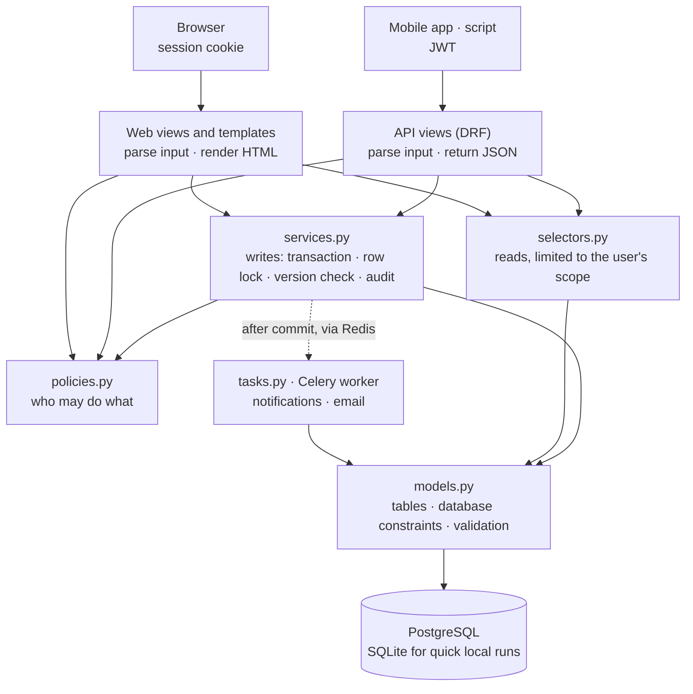

# Architecture

How EduNexa's code is organised today, and how a request moves through it. For where the project is heading, see [DESIGN.md](DESIGN.md).

## The big picture

EduNexa is a **modular monolith**: one Django project and one database, split into domain apps with strict rules about which app may use which.

## Layers

`INSTALLED_APPS` lists the apps from the lowest layer to the highest. An app may import only from apps listed before it, so there are no circular dependencies.

| Layer | Apps | Responsibility |
|---|---|---|
| 0 | `core` | Base model, security headers, pagination, template tags, health check; shared API code (errors, permissions, pagination, sorting) |
| 1 | `organization`, `audit`, `accounts` | School group and branches; the activity log; users, roles and sign-in |
| 2 | `academics`, `students` | Years, classrooms, subjects, teacher assignments; students, enrollments and guardians |
| 3 | `communication`, `attendance`, `exams` | Announcements and notifications; daily registers and leave; exams, marks and the result workflow |
| 4 | `reports`, `demo` | Dashboards, reports and report-card PDFs that read from everything; sample data |

Two places needed care to keep this rule:

- **Enrollment's "no retroactive joins" rule** needs to know whether registers or published exams exist. `students` is below `attendance` and `exams`, so it reads them through the classroom's reverse relations (`classroom.attendance_sessions`, `classroom.exams`) instead of importing those apps.
- **The activity-log page** lives in `reports`, not `audit`. `audit` stays a small piece of infrastructure (model, `audit()`, `events()`) that `accounts` and every app above it can use.
- **The branches API endpoint** lives in `academics`, not `organization`, because creating a branch writes the activity log and `organization` sits below `audit`.

## Inside an app

Every domain app has the same shape:

| File | Holds | Example |
|---|---|---|
| `models.py` | Tables, constraints, `clean()` validation | `Exam`, `Mark` |
| `selectors.py` | Read queries already filtered to the user's scope | `exams(user)`, `mark_summary(marks)` |
| `policies.py` | Yes/no permission checks | `can_mark(user, exam)`, `can_create_exam(user, classroom, subject)` |
| `services.py` | Every write, checking its own policy | `save_marks(...)`, `transition_exam(...)` |
| `tasks.py` | Background jobs (Celery) the services queue | `announce_results(exam_id, version)` |
| `forms.py`, `views.py`, `urls.py`, `templates/` | The web layer | |
| `api/` | The REST API: `serializers.py`, `views.py`, `urls.py`, `filters.py` | `ExamViewSet`, `RegisterView` |
| `tests/` | Tests for that app, and `factories.py` (factory_boy) | `test_results.py`, `test_api_exams.py` |

Web views and API views stay thin. They read the request, call a selector or service, then render a template or return JSON. Both get exactly the same rules, because the rules exist only once. See [API.md](API.md) and [ADR 0006](adr/0006-rest-api.md).

## A request, step by step: saving a mark sheet

1. `POST /exams/<id>/` reaches `exams.views.exam_detail`.
2. The view loads the exam through `exams.selectors.exams(user)`. A teacher can't even load another branch's exam, so the response is 404, not 403.
3. `MarkSheetForm` validates each score (between 0 and the maximum; a score or "absent", not both).
4. `exams.services.save_marks()` takes over, inside one transaction:
   - locks the classroom row and the exam row (`select_for_update`);
   - re-checks the policy `can_mark()`, so the service is safe even if a view forgets;
   - compares the form's version number with the database, raising `Conflict` if someone saved in between;
   - refuses edits unless the exam is a draft;
   - checks the marks cover exactly the students enrolled on the exam date;
   - writes the marks, bumps the version, and records an audit event with before/after values.
5. Any error rolls the whole sheet back; there is never a half-saved mark sheet.

Daily registers (`attendance.services.save_register`) follow the same pattern.

## The same save through the API

`PUT /api/v1/exams/<id>/marks/` with a JSON body reaches `exams.api.views.ExamViewSet.marks`:

1. DRF authenticates the JWT. The `IsSignedIn` and `role_in(...)` permissions play the part of `@login_required` and `@role_required`.
2. `get_object()` loads the exam through the same `exams(user)` selector, so out of scope is again a 404.
3. `MarkSheetSaveSerializer` checks the JSON's shape: a version, and each student listed once with a non-negative score. The rest ("a score or absent, not both", "not above the maximum") is the `Mark` model's own validation, which runs when the service saves.
4. The view calls the same `save_marks()` service as the web page: same locks, policy check, version check, roster check and audit event.
5. If the service raises `Conflict`, the API's exception handler turns it into `409 conflict`; a `ValidationError` becomes a 400 and `PermissionDenied` a 403.

## Background jobs

Slow or external work (email, notifying a whole audience) runs in a Celery worker, fed through Redis.

- **Queued after commit.** Services call `apps.core.jobs.run_after_commit(task, ...)`, never `task.delay()`. A job never runs for a save that was rolled back, and never starts before the worker can see the new rows.
- **Safe to run twice.** Jobs are acknowledged only when they finish, so a crashed worker's job is retried. Every notification carries a key (`absence:41:2026-11-06`, `results:12:3`) that is unique per recipient, so a retry notifies and emails nobody twice.
- **They re-check the facts.** An absence alert skips a student corrected to present in the meantime; a results announcement skips an exam reopened in the meantime.
- **No Redis, no worker.** Without `REDIS_URL` (the quick Windows run), jobs run inside the request right after the commit. Same code, no extra process.
- **Bulk loads pause them.** `jobs_paused()` lets the demo seed record three months of history without alerting anyone.
- `celery beat` runs scheduled jobs (nightly clean-up of expired API tokens). `manage.py check_jobs` sends a job through Redis and waits for a worker's answer; CI runs it against a real worker.

## Caching

Dashboard aggregates over every attendance row (the 30-day trend, students below 75%, branches compared) are cached in Redis. Each key includes a fingerprint of the registers in scope: how many there are, plus the sum of their version numbers. Every save, correction or leave approval changes it, so a changed register means a new key: the cache never serves stale numbers and nothing has to delete keys. The fingerprint comes from the small registers table, so checking it is far cheaper than recomputing.

## Security layers

- **Middleware:** `SecurityHeadersMiddleware` adds a strict Content-Security-Policy, referrer and permissions policies, and `no-store` for signed-in pages and every API response. `ForcePasswordChangeMiddleware` holds new accounts on the password page.
- **Views:** `@role_required(*User.MANAGERS)` returns 403 for the wrong role. API views use the matching `role_in(...)` permission, which also enforces the first password change.
- **Tokens:** API access tokens last 15 minutes. Refresh tokens rotate and are blacklisted after use, and a password change or deactivation revokes them.
- **Selectors:** out-of-scope records return 404, so a changed ID in the URL reveals nothing.
- **Services:** re-check policies and lock rows before writing.
- **Database:** constraints reject invalid data even if every layer above had a bug.

## Settings

| Module | Used by | Behaviour |
|---|---|---|
| `config/settings/base.py` | everything | Shared settings, secure by default |
| `config/settings/dev.py` | `manage.py` (default) | Debug pages, SQLite unless `DATABASE_URL`, emails in the console |
| `config/settings/prod.py` | WSGI server and Docker image (default) | Refuses to start without a secret key and PostgreSQL |
| `config/settings/test.py` | pytest | Fast password hashing, in-memory email, no `.env` needed |

## Front end

Server-rendered Django templates with no build step:

- `static/css/tokens.css` defines every colour, font and radius. Dark mode redefines only those tokens.
- `base.css`, `layout.css` and `components.css` hold the rest. Templates combine classes; pages add no CSS of their own.
- `static/img/icons.svg` is one icon sprite, drawn with ``.
- `static/js/` adds small enhancements: the mobile menu, confirmations, printing, "mark all present" and the theme toggle. Every page works without JavaScript.
- There are no inline scripts, so the Content-Security-Policy can forbid them.

## Tests

Each app's tests live in its `tests/` folder and share a small school fixture (`apps/core/testing.py`: two branches, every role, two students, three exams). `ApiTestCase` adds DRF's test client. The concurrency tests use real threads and real transactions and run on PostgreSQL in CI.

Background jobs run inside the test (`CELERY_TASK_ALWAYS_EAGER`), and tests that check them wrap the save in `captureOnCommitCallbacks(execute=True)`, the same after-commit path as production. Every test starts with an empty cache.

Each app's `tests/factories.py` holds factory_boy factories that build valid records with as many rows as a test needs. The query-count tests use them to prove that no API list runs a query per row. One table-driven test checks every API endpoint for every role.
