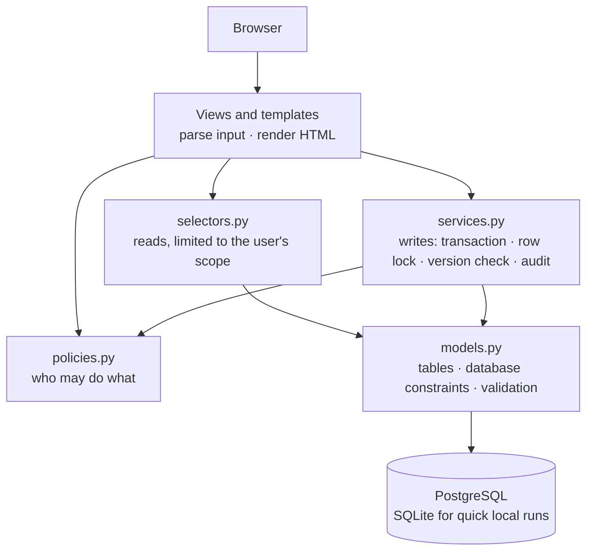

# Architecture

How EduNexa's code is organised today, and how a request moves through it. For where the project is heading, see [DESIGN.md](DESIGN.md).

## The big picture

EduNexa is a **modular monolith**: one Django project and one database, split into domain apps with strict rules about which app may use which.

## Layers

`INSTALLED_APPS` lists the apps from the lowest layer to the highest. An app may import only from apps listed before it, so there are no circular dependencies.

| Layer | Apps | Responsibility |
|---|---|---|
| 0 | `core` | Base model, security headers, pagination, template tags, health check |
| 1 | `organization`, `audit`, `accounts` | School group and branches; the activity log; users, roles and sign-in |
| 2 | `academics`, `students` | Years, classrooms, subjects, teacher assignments; students and enrollments |
| 3 | `attendance`, `exams` | Daily registers; exams, marks and the result workflow |
| 4 | `reports`, `demo` | Pages that read from everything; sample data |

Two places needed care to keep this rule:

- **Enrollment's "no retroactive joins" rule** needs to know whether registers or published exams exist. `students` is below `attendance` and `exams`, so it reads them through the classroom's reverse relations (`classroom.attendance_sessions`, `classroom.exams`) instead of importing those apps.
- **The activity-log page** lives in `reports`, not `audit`. `audit` stays a small piece of infrastructure (model, `audit()`, `events()`) that `accounts` and every app above it can use.

## Inside an app

Every domain app has the same shape:

| File | Holds | Example |
|---|---|---|
| `models.py` | Tables, constraints, `clean()` validation | `Exam`, `Mark` |
| `selectors.py` | Read queries already filtered to the user's scope | `exams(user)`, `mark_summary(marks)` |
| `policies.py` | Yes/no permission checks | `can_mark(user, exam)`, `can_publish(user, exam)` |
| `services.py` | Every write | `save_marks(...)`, `transition_exam(...)` |
| `forms.py`, `views.py`, `urls.py`, `templates/` | The web layer | |
| `tests/` | Tests for that app | `test_results.py`, `test_concurrency.py` |

Views stay thin. They read the request, call a selector or service, then render a template or redirect. A future REST API can call the same services and get exactly the same rules.

## A request, step by step: saving a mark sheet

1. `POST /exams/<id>/` reaches `exams.views.exam_detail`.
2. The view loads the exam through `exams.selectors.exams(user)`. A teacher can't even load another branch's exam, so the response is 404, not 403.
3. `MarkSheetForm` validates each score (between 0 and the maximum; a score or "absent", not both).
4. `exams.services.save_marks()` takes over, inside one transaction:
   - locks the classroom row and the exam row (`select_for_update`);
   - re-checks the policy `can_mark()`, so the service is safe even if a view forgets;
   - compares the form's version number with the database, raising `Conflict` if someone saved in between;
   - refuses edits unless the exam is a draft;
   - checks the marks cover exactly the students enrolled on the exam date;
   - writes the marks, bumps the version, and records an audit event with before/after values.
5. Any error rolls the whole sheet back; there is never a half-saved mark sheet.

Daily registers (`attendance.services.save_register`) follow the same pattern.

## Security layers

- **Middleware:** `SecurityHeadersMiddleware` adds a strict Content-Security-Policy, referrer and permissions policies, and `no-store` for signed-in pages. `ForcePasswordChangeMiddleware` holds new accounts on the password page.
- **Views:** `@role_required(*User.MANAGERS)` returns 403 for the wrong role.
- **Selectors:** out-of-scope records return 404, so a changed ID in the URL reveals nothing.
- **Services:** re-check policies and lock rows before writing.
- **Database:** constraints reject invalid data even if every layer above had a bug.

## Settings

| Module | Used by | Behaviour |
|---|---|---|
| `config/settings/base.py` | everything | Shared settings, secure by default |
| `config/settings/dev.py` | `manage.py` (default) | Debug pages, SQLite unless `DATABASE_URL`, emails in the console |
| `config/settings/prod.py` | WSGI server and Docker image (default) | Refuses to start without a secret key and PostgreSQL |
| `config/settings/test.py` | pytest | Fast password hashing, in-memory email, no `.env` needed |

## Front end

Server-rendered Django templates with no build step:

- `static/css/tokens.css` defines every colour, font and radius. Dark mode redefines only those tokens.
- `base.css`, `layout.css` and `components.css` hold the rest. Templates combine classes; pages add no CSS of their own.
- `static/img/icons.svg` is one icon sprite, drawn with ``.
- `static/js/` adds small enhancements: the mobile menu, confirmations, printing, "mark all present" and the theme toggle. Every page works without JavaScript.
- There are no inline scripts, so the Content-Security-Policy can forbid them.

## Tests

Each app's tests live in its `tests/` folder and share a small school fixture (`apps/core/testing.py`: two branches, every role, two students, three exams). The concurrency tests use real threads and real transactions and run on PostgreSQL in CI.
