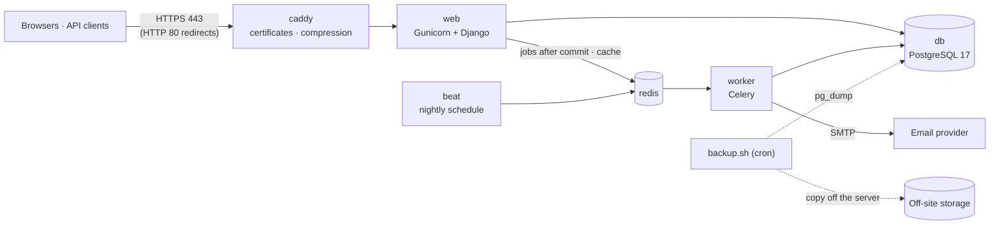

# Deploying EduNexa

EduNexa runs on one Linux server with Docker Compose: Caddy (HTTPS) in front of the app, a Celery worker and scheduler, PostgreSQL and Redis. Everything needed is in [`deploy/`](../deploy/). **Nothing is deployed online yet**: no hosting has been bought, and going live needs the owner's approval.

The whole stack has been rehearsed locally under production settings (`python e2e/rehearse_deploy.py`): HTTPS, the security headers, the API checks, a real browser for every role, and a backup and restore drill.

## What runs



| Service | What it does | Reachable from outside |
|---|---|---|
| `caddy` | HTTPS with automatic Let's Encrypt certificates, HTTP→HTTPS redirect, compression, a 5 MB request limit, access logs | Ports 80 and 443 |
| `web` | Django under Gunicorn (`WEB_CONCURRENCY` workers) | No |
| `worker` | Celery: emails, notifications, receipts | No |
| `beat` | Celery's scheduler: nightly jobs (exactly one) | No |
| `db` | PostgreSQL 17, data in the `postgres_data` volume | No |
| `redis` | The job queue and the shared cache (nothing in it needs to survive a restart) | No |

The image ([`Dockerfile`](../Dockerfile)) runs as a non-root user, carries its static files (collected at build time), and has a health check: `/health/`, which also checks the database. Caddy starts only once the app is healthy.

Scheduled jobs: overdue-fee reminders (09:00), the leavers' access review (02:30), expired-token clean-up (03:15), and in demo mode the demo reset (03:45).

## A server

Any small Linux VPS works for a school group of a few hundred students: 2 vCPU, 4 GB RAM, 40 GB disk, Ubuntu 24.04 LTS. You also need:

- a domain or subdomain (for example `school.example.com`);
- an SMTP provider for password resets and notices;
- somewhere off the server for backups.

1. Point the domain's DNS A (and AAAA) record at the server.
2. Install Docker Engine with the Compose plugin ([docs.docker.com/engine/install/ubuntu](https://docs.docker.com/engine/install/ubuntu/)).
3. Allow only SSH, HTTP and HTTPS: `ufw allow OpenSSH && ufw allow 80,443/tcp && ufw allow 443/udp && ufw enable`.
4. Turn on unattended security updates (`apt install unattended-upgrades`).
5. Use SSH keys, not passwords.

## First deploy

```sh
git clone https://github.com/Sandeepjanjirala/edunexa.git /opt/edunexa && cd /opt/edunexa/deploy
cp env.production.example .env && chmod 600 .env
# Fill in every value in .env: the domain, secrets, SMTP. Generate secrets with
#   python3 -c "import secrets; print(secrets.token_urlsafe(60))"
docker compose -f compose.production.yaml build
docker compose -f compose.production.yaml up --detach --wait db redis
docker compose -f compose.production.yaml run --rm web python manage.py migrate --noinput
docker compose -f compose.production.yaml run --rm web python manage.py check --deploy
docker compose -f compose.production.yaml run --rm web python manage.py createsuperuser
docker compose -f compose.production.yaml up --detach --wait
docker compose -f compose.production.yaml exec web python manage.py check_jobs
```

Then open `https://<your domain>`, sign in as the super admin, and follow the setup steps in the README.

Production refuses to start, with a message naming the setting, unless:

- `SITE_URL` is `https://`;
- its host is in `ALLOWED_HOSTS` and its origin is in `CSRF_TRUSTED_ORIGINS`;
- `DJANGO_SECRET_KEY` has at least 50 characters;
- `DATABASE_URL`, `REDIS_URL` and `EMAIL_HOST` are set (`EMAIL_HOST` is optional in demo mode).

Never seed demo data on a real school's database. `seed_demo` refuses a database that has data anyway.

## Settings

All settings live in `deploy/.env`, which is ignored by Git; see [`env.production.example`](../deploy/env.production.example). The compose file sets `DATABASE_URL`, `REDIS_URL`, `TRUST_PROXY=1` and the production settings module itself.

| Variable | Meaning |
|---|---|
| `SITE_DOMAIN`, `SITE_URL`, `ALLOWED_HOSTS`, `CSRF_TRUSTED_ORIGINS` | The address people open, in the four forms Caddy and Django need |
| `CADDY_TLS` | An email address (Let's Encrypt; expiry notices go there), or `internal` for a local rehearsal |
| `DJANGO_SECRET_KEY` | Random, 50+ characters. It also signs API tokens: changing it signs every API client out |
| `POSTGRES_PASSWORD` | The database password (URL-safe characters) |
| `EMAIL_HOST`, `EMAIL_PORT`, `EMAIL_USE_TLS`, `EMAIL_HOST_USER`, `EMAIL_HOST_PASSWORD`, `DEFAULT_FROM_EMAIL` | SMTP for password resets, notices and receipts |
| `ERROR_EMAILS` | Optional: comma-separated addresses that get an email for every server error |
| `RAZORPAY_KEY_ID`, `RAZORPAY_KEY_SECRET`, `RAZORPAY_WEBHOOK_SECRET` | Optional, **test keys only** (`rzp_test_…`). Without them the Sandbox takes test payments. Webhook: `https://<host>/api/v1/payments/webhook/razorpay/` |
| `LEAVER_GRACE_DAYS`, `LEAVER_FEES_GRACE_DAYS` | Parents' access after their children leave: 30 days, or 90 while fees are owed ([ADR 0013](adr/0013-leaving-and-access.md)) |
| `WEB_CONCURRENCY`, `WORKER_CONCURRENCY` | Gunicorn and Celery processes (3 and 2 suit the server above) |
| `DEMO_MODE`, `DEMO_SIZE` | The public demo only ([below](#the-public-demo)) |

## Releasing a new version

```sh
cd /opt/edunexa && git pull
cd deploy && ./backup.sh                       # always, before migrating
docker compose -f compose.production.yaml build
docker compose -f compose.production.yaml run --rm web python manage.py migrate --noinput
docker compose -f compose.production.yaml up --detach --wait
```

Migrations run once per release, as their own step, before the new code serves requests. Every migration since v0.1.0 is rehearsed on real data copies (`e2e/rehearse_migrations.py`).

**To roll back:** check out the previous tag, rebuild, and restore the backup taken before the release (below).

## Backups

[`deploy/backup.sh`](../deploy/backup.sh) writes a compressed PostgreSQL archive to `deploy/backups/`. It checks that the archive can be read, and removes archives older than `KEEP_DAYS` (14). Run it nightly from cron:

```text
15 1 * * * /opt/edunexa/deploy/backup.sh >> /var/log/edunexa-backup.log 2>&1
```

**Copy `deploy/backups/` off the server** every night as well (another machine, or object storage with a tool such as `rclone`). A backup on the same disk does not survive losing the disk.

### Restoring

```sh
cd /opt/edunexa/deploy && ./restore.sh backups/edunexa-20261110-011500.dump --yes
```

[`restore.sh`](../deploy/restore.sh) works in this order:

1. It loads the archive into a new database. If that fails, nothing changes.
2. It stops the app.
3. It swaps the new database in and keeps the old one as `edunexa_replaced_<time>`, so the restore itself can be undone.
4. It runs migrations and starts the app.

Drop the kept database once you're sure. The rehearsal runs this whole drill and compares every table with the backup, row for row.

**Test a restore at least once a term**, on a copy of the server or on your machine.

## Monitoring and logs

- `docker compose -f compose.production.yaml ps` shows each service's health; `logs -f web` follows the app.
- Every log line carries the request id: the same id as the `X-Request-ID` response header and as the activity-log entries the request wrote. So "what happened when I clicked at 10:42?" can be traced.
- `ERROR_EMAILS` gets every server error by email. An uptime monitor (any provider) should poll `https://<host>/health/`.
- Logs rotate (10 MB × 5 per service).

## Security

- Only Caddy is reachable. HTTPS everywhere, with HSTS for a year.
- A strict Content-Security-Policy (`script-src 'self'`; no third-party requests).
- Secure, HttpOnly, SameSite cookies; sessions end after 8 hours or when the browser closes.
- Every account is created by an administrator (no public sign-up). Sign-in attempts are limited. The API uses short-lived tokens with rotation.
- Accounts switched off, by an administrator or the leavers' review, lose their web sessions and API tokens at once.
- Secrets stay in `deploy/.env` on the server (mode 600), never in Git or in the image.
- Database operators can still change data: the activity log is a record, not tamper-proof.

## The public demo

The demo is the same stack with `DEMO_MODE=1` in `deploy/.env` ([ADR 0014](adr/0014-demo-mode.md)):

- one-click logins for every role;
- a banner on every page;
- no real emails, Sandbox payments only;
- a nightly reset to fresh synthetic data.

Seed it once after the first deploy:

```sh
docker compose -f compose.production.yaml run --rm web python manage.py seed_demo
```

Use a separate server or database from any real school. The reset refuses any database that `seed_demo` didn't create anyway.

## Before admitting pilot users

1. Deploy to the chosen host (with approval), and run `check --deploy` there.
2. Test a password-reset email with a real pilot account.
3. Confirm teacher assignments and branch scopes using separate real test accounts.
4. Set up the nightly backup, the off-server copy and an uptime monitor, and do one restore drill on the server.
5. Check the portal on the phones and browsers the pilot will use. Layouts have been checked in a real browser at phone and desktop sizes, not on real devices.
6. Payments stay in test mode. Going live needs live keys, a reviewed change to the test-mode guard in `config/settings/base.py`, a live check of the checkout page's CSP, the Sandbox disabled, and finance sign-off ([backlog](BACKLOG.md)).

## Without Docker

The same settings work on any host that runs Python 3.12, PostgreSQL and Redis behind an HTTPS proxy. Use `config.settings.prod`, then:

1. run `manage.py collectstatic`;
2. run `migrate` once per release;
3. start Gunicorn (`config.wsgi:application`), one `celery -A config worker` and exactly one `celery -A config beat`.

Set `TRUST_PROXY=1` only if the proxy overwrites `X-Forwarded-Proto`.

References: [Django's deployment checklist](https://docs.djangoproject.com/en/5.2/howto/deployment/checklist/), [Caddy's automatic HTTPS](https://caddyserver.com/docs/automatic-https).
